

  

<a href="https://arya-wiguna.my.id">
  <picture><source media="(min-width: 701px)" srcset="assets/id/hero.svg"></picture>
</a>

  
  
  
  

<picture><source media="(min-width: 701px)" srcset="assets/id/abyss.svg"></picture>

<picture><source media="(min-width: 701px)" srcset="assets/id/layer-01.svg">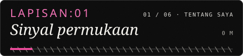</picture>
<picture><source media="(min-width: 701px)" srcset="assets/id/about.svg">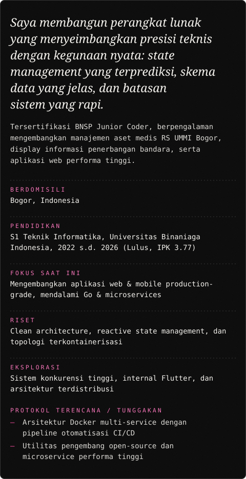</picture>

<picture><source media="(min-width: 701px)" srcset="assets/id/layer-02.svg">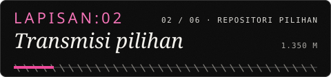</picture>
<!--PINNED:START-->
<a href="https://github.com/AryaWgna/api_tobe_store"><picture><source media="(min-width: 701px)" srcset="assets/id/pinned/api_tobe_store.svg">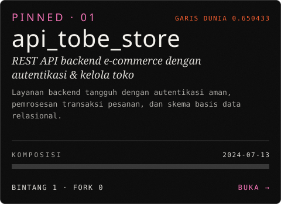</picture></a>
<a href="https://github.com/AryaWgna/SIMARU-Mobile-App"><picture><source media="(min-width: 701px)" srcset="assets/id/pinned/SIMARU-Mobile-App.svg">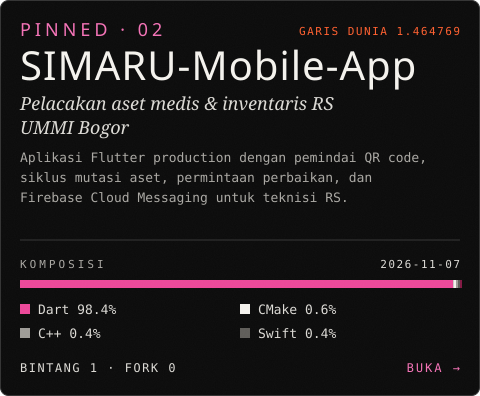</picture></a>
<a href="https://github.com/AryaWgna/PMB"><picture><source media="(min-width: 701px)" srcset="assets/id/pinned/PMB.svg">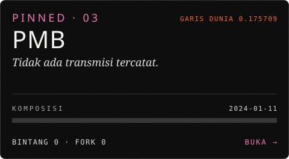</picture></a>
<a href="https://github.com/AryaWgna/Program-PMB"><picture><source media="(min-width: 701px)" srcset="assets/id/pinned/Program-PMB.svg">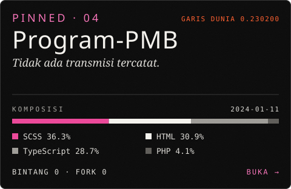</picture></a>
<a href="https://github.com/AryaWgna/go-restapi-gin"><picture><source media="(min-width: 701px)" srcset="assets/id/pinned/go-restapi-gin.svg">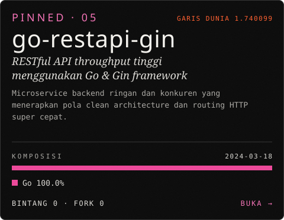</picture></a>
<a href="https://github.com/AryaWgna/revou_tes_day1"><picture><source media="(min-width: 701px)" srcset="assets/id/pinned/revou_tes_day1.svg">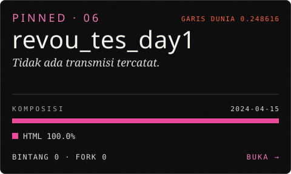</picture></a>
<!--PINNED:END-->

<picture><source media="(min-width: 701px)" srcset="assets/id/layer-03.svg">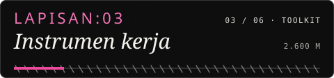</picture>
<picture><source media="(min-width: 701px)" srcset="assets/id/toolkit.svg">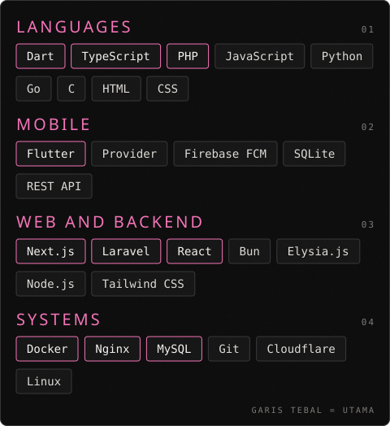</picture>

<picture><source media="(min-width: 701px)" srcset="assets/id/layer-04.svg">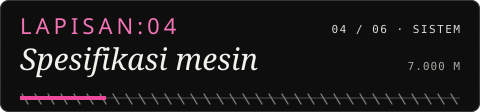</picture>
<picture><source media="(min-width: 701px)" srcset="assets/id/system.svg">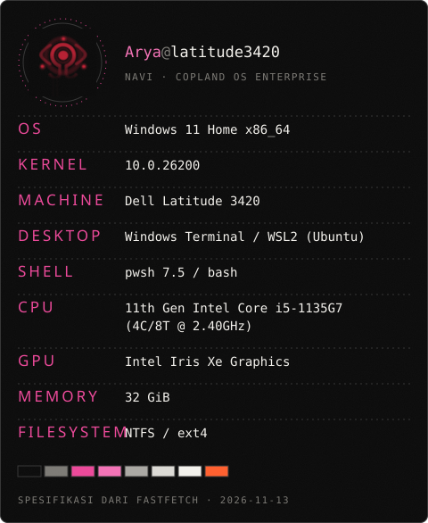</picture>

<picture><source media="(min-width: 701px)" srcset="assets/id/layer-05.svg">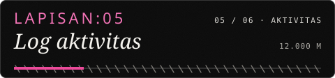</picture>
<picture><source media="(min-width: 701px)" srcset="assets/id/signal.svg"></picture>

<picture><source media="(min-width: 701px)" srcset="assets/id/layer-06.svg">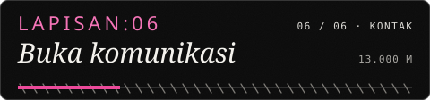</picture>

  <a href="https://arya-wiguna.my.id">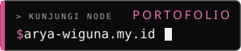</a>
  <a href="https://www.linkedin.com/in/arya-wgna">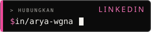</a>
  <a href="mailto:wgnarya123@gmail.com">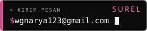</a>
  <a href="https://github.com/AryaWgna">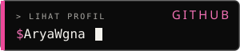</a>

<picture><source media="(min-width: 701px)" srcset="assets/id/footer.svg"></picture>
