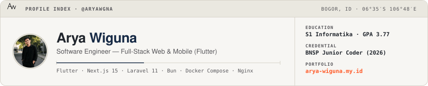
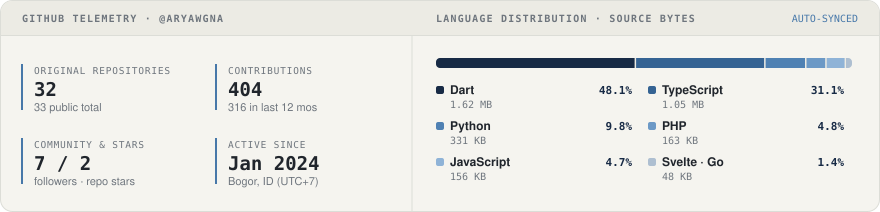
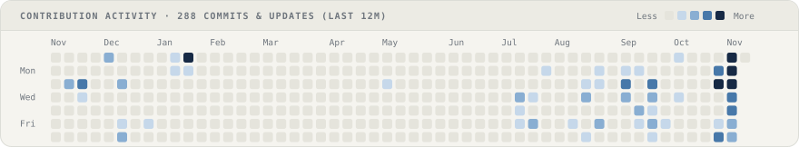
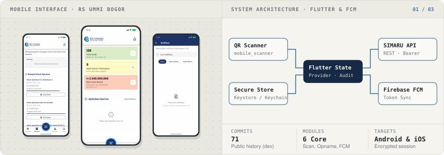
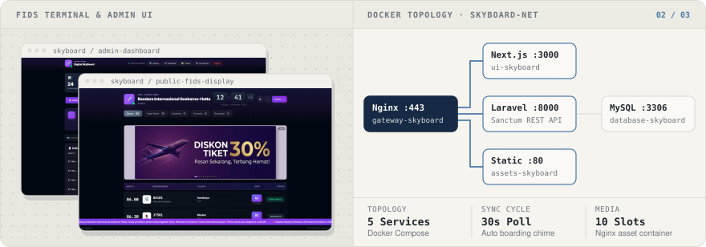
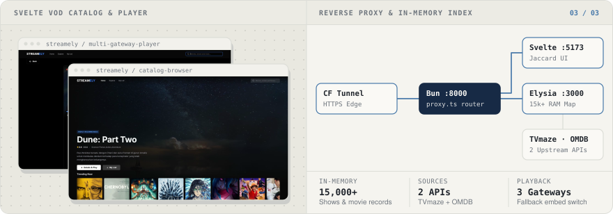

<a href="https://arya-wiguna.my.id">
  <picture>
    <source media="(prefers-color-scheme: dark)" srcset="./assets/masthead-dark.svg" />
    <source media="(prefers-color-scheme: light)" srcset="./assets/masthead-light.svg" />
    
  </picture>
</a>

  <a href="https://arya-wiguna.my.id">
    <picture>
      <source media="(prefers-color-scheme: dark)" srcset="https://img.shields.io/badge/portfolio-arya--wiguna.my.id-2B4C73?style=flat-square&amp;labelColor=1A222B" />
      
    </picture>
  </a>
  <a href="https://github.com/AryaWgna?tab=followers">
    <picture>
      <source media="(prefers-color-scheme: dark)" srcset="https://img.shields.io/github/followers/AryaWgna?style=flat-square&amp;label=followers&amp;labelColor=1A222B&amp;color=2B4C73" />
      
    </picture>
  </a>
  <a href="https://github.com/AryaWgna?tab=repositories">
    <picture>
      <source media="(prefers-color-scheme: dark)" srcset="https://img.shields.io/github/stars/AryaWgna?affiliations=OWNER&amp;style=flat-square&amp;label=stars&amp;labelColor=1A222B&amp;color=2B4C73" />
      
    </picture>
  </a>
  <a href="#credentials">
    <picture>
      <source media="(prefers-color-scheme: dark)" srcset="https://img.shields.io/badge/bnsp-junior_coder-2B4C73?style=flat-square&amp;labelColor=1A222B" />
      
    </picture>
  </a>
  <a href="https://www.linkedin.com/in/arya-wgna">
    <picture>
      <source media="(prefers-color-scheme: dark)" srcset="https://img.shields.io/badge/linkedin-arya--wgna-2B4C73?style=flat-square&amp;labelColor=1A222B" />
      
    </picture>
  </a>

<strong>English</strong> · <a href="README.id.md">Bahasa Indonesia</a> &nbsp;|&nbsp; <a href="#about">About</a> · <a href="#github-telemetry">Telemetry</a> · <a href="#featured-work">Featured Work</a> · <a href="#technical-stack">Stack</a> · <a href="#credentials">Credentials</a> · <a href="#contact">Contact</a>

---

## About

Informatics Engineering graduate (**S1 Teknik Informatika**, Universitas Binaniaga Indonesia — GPA **3.77 / 4.00**) and **BNSP-certified Junior Coder** based in Bogor, Indonesia. I build field-tested mobile applications in **Flutter** alongside multi-service web backends with **Next.js 15**, **Laravel 11**, and **Bun / Elysia.js**.

- **Hospital Field Engineering:** 5-month IT Support & Mobile Developer internship at **RS UMMI Bogor** (Feb – Jul 2025), building internal mobile tooling for QR-based medical equipment inspection and room-by-room stock opname audits.
- **Architectural Discipline:** Explicit service boundaries, normalized relational schemas, and predictable state management without unnecessary framework layers.
- **Direct Evidence:** Every system and credential below links directly to its public source repository, official verification page, or scanned certificate PDF.

---

## GitHub Telemetry

Live repository metrics, source-byte language distribution across non-fork repositories, and 12-month contribution history (synced automatically every 12 hours via [`.github/workflows/telemetry.yml`](.github/workflows/telemetry.yml)):

  <a href="https://github.com/AryaWgna?tab=repositories">
    <picture>
      <source media="(prefers-color-scheme: dark)" srcset="./assets/telemetry-dark.svg" />
      <source media="(prefers-color-scheme: light)" srcset="./assets/telemetry-light.svg" />
      
    </picture>
  </a>

  <picture>
    <source media="(prefers-color-scheme: dark)" srcset="./assets/contributions-dark.svg" />
    <source media="(prefers-color-scheme: light)" srcset="./assets/contributions-light.svg" />
    
  </picture>

---

## Featured Work

### 01 · SIMARU Mobile App — RS UMMI Bogor
**Hospital Medical Asset Inspection & Push Notification App** · `Flutter` `Dart` `Firebase FCM` `REST API`

  <a href="https://arya-wiguna.my.id/work/simaru-mobile-app">
    <picture>
      <source media="(prefers-color-scheme: dark)" srcset="./assets/project-simaru-dark.svg" />
      <source media="(prefers-color-scheme: light)" srcset="./assets/project-simaru-light.svg" />
      
    </picture>
  </a>

Developed during my internship at **RS UMMI Bogor** so hospital technicians can audit medical equipment directly on ward floors instead of carrying paper spreadsheets. Integrates `mobile_scanner` QR camera lookup, building/room-scoped `StockOpnameController` condition audits, damage complaint reporting with photo uploads, encrypted `flutter_secure_storage` Bearer tokens, and background `FcmTokenManager` device push registration.

  <a href="https://github.com/AryaWgna/SIMARU-Mobile-App">
    <picture>
      <source media="(prefers-color-scheme: dark)" srcset="https://img.shields.io/github/last-commit/AryaWgna/SIMARU-Mobile-App?style=flat-square&amp;label=last%20commit&amp;labelColor=1A222B&amp;color=2B4C73" />
      
    </picture>
  </a>
  <a href="https://github.com/AryaWgna/SIMARU-Mobile-App">
    <picture>
      <source media="(prefers-color-scheme: dark)" srcset="https://img.shields.io/github/languages/top/AryaWgna/SIMARU-Mobile-App?style=flat-square&amp;labelColor=1A222B&amp;color=2B4C73" />
      
    </picture>
  </a>
  <a href="https://github.com/AryaWgna/SIMARU-Mobile-App">
    <picture>
      <source media="(prefers-color-scheme: dark)" srcset="https://img.shields.io/github/repo-size/AryaWgna/SIMARU-Mobile-App?style=flat-square&amp;label=repo%20size&amp;labelColor=1A222B&amp;color=2B4C73" />
      
    </picture>
  </a>
  &nbsp;
  <a href="https://github.com/AryaWgna/SIMARU-Mobile-App"><strong>Source repository ↗</strong></a> · <a href="https://arya-wiguna.my.id/work/simaru-mobile-app"><strong>Case study &amp; architecture ↗</strong></a>

---

### 02 · Digital Skyboard Announcement
**Airport Flight Information Display System (FIDS)** · `Next.js 15` `Laravel 11` `MySQL 8.0` `Docker Compose` `Nginx`

  <a href="https://arya-wiguna.my.id/work/digital-skyboard-announcement">
    <picture>
      <source media="(prefers-color-scheme: dark)" srcset="./assets/project-skyboard-dark.svg" />
      <source media="(prefers-color-scheme: light)" srcset="./assets/project-skyboard-light.svg" />
      
    </picture>
  </a>

Terminal flight information display orchestrated across **5 Docker containers** (`database-skyboard` MySQL 8.0, `api-skyboard` Laravel 11 + Sanctum, `ui-skyboard` Next.js 15, `assets-skyboard` dedicated static Nginx server, and `gateway-skyboard` TLS Nginx reverse proxy on the internal `skyboard-net` bridge). Terminal displays poll `/api/flights` every 30 seconds, trigger audio chimes on boarding status transitions, and rotate 10 promotional banners managed from a Sanctum-protected operator dashboard.

  <a href="https://github.com/AryaWgna/Digital-Skyboard-Announcement">
    <picture>
      <source media="(prefers-color-scheme: dark)" srcset="https://img.shields.io/github/last-commit/AryaWgna/Digital-Skyboard-Announcement?style=flat-square&amp;label=last%20commit&amp;labelColor=1A222B&amp;color=2B4C73" />
      
    </picture>
  </a>
  <a href="https://github.com/AryaWgna/Digital-Skyboard-Announcement">
    <picture>
      <source media="(prefers-color-scheme: dark)" srcset="https://img.shields.io/github/languages/top/AryaWgna/Digital-Skyboard-Announcement?style=flat-square&amp;labelColor=1A222B&amp;color=2B4C73" />
      
    </picture>
  </a>
  <a href="https://github.com/AryaWgna/Digital-Skyboard-Announcement">
    <picture>
      <source media="(prefers-color-scheme: dark)" srcset="https://img.shields.io/github/repo-size/AryaWgna/Digital-Skyboard-Announcement?style=flat-square&amp;label=repo%20size&amp;labelColor=1A222B&amp;color=2B4C73" />
      
    </picture>
  </a>
  &nbsp;
  <a href="https://github.com/AryaWgna/Digital-Skyboard-Announcement"><strong>Source repository ↗</strong></a> · <a href="https://arya-wiguna.my.id/work/digital-skyboard-announcement"><strong>Case study &amp; architecture ↗</strong></a>

---

### 03 · StreamEly
**Self-Hosted VOD Metadata Aggregator & Multi-Gateway Player** · `Bun` `Elysia.js` `Svelte` `TypeScript`

  <a href="https://arya-wiguna.my.id/work/streamely">
    <picture>
      <source media="(prefers-color-scheme: dark)" srcset="./assets/project-streamely-dark.svg" />
      <source media="(prefers-color-scheme: light)" srcset="./assets/project-streamely-light.svg" />
      
    </picture>
  </a>

Lightweight media catalog routed through a custom `Bun.serve` reverse proxy (`:8000`) that forwards `/api/*` to **Elysia.js** (`:3000`) and `/` to **Svelte** (`:5173`) while stripping upstream `content-encoding` headers to prevent decode errors behind Cloudflare Tunnel. Preloads 15,000+ TVmaze and OMDB records into server memory (`showsDB[]` and `moviesDB`), computes client-side Jaccard genre/cast similarity scores, and provides 3 fallback embed gateways.

  <a href="https://github.com/AryaWgna/streamely">
    <picture>
      <source media="(prefers-color-scheme: dark)" srcset="https://img.shields.io/github/last-commit/AryaWgna/streamely?style=flat-square&amp;label=last%20commit&amp;labelColor=1A222B&amp;color=2B4C73" />
      
    </picture>
  </a>
  <a href="https://github.com/AryaWgna/streamely">
    <picture>
      <source media="(prefers-color-scheme: dark)" srcset="https://img.shields.io/github/languages/top/AryaWgna/streamely?style=flat-square&amp;labelColor=1A222B&amp;color=2B4C73" />
      
    </picture>
  </a>
  <a href="https://github.com/AryaWgna/streamely">
    <picture>
      <source media="(prefers-color-scheme: dark)" srcset="https://img.shields.io/github/repo-size/AryaWgna/streamely?style=flat-square&amp;label=repo%20size&amp;labelColor=1A222B&amp;color=2B4C73" />
      
    </picture>
  </a>
  &nbsp;
  <a href="https://github.com/AryaWgna/streamely"><strong>Source repository ↗</strong></a> · <a href="https://arya-wiguna.my.id/work/streamely"><strong>Case study &amp; architecture ↗</strong></a>

---

## Technical Stack

Tools and runtimes directly backed by public repositories and verified technical credentials:

<table>
  <thead>
    <tr>
      <th align="left">Domain</th>
      <th align="left">Technologies</th>
    </tr>
  </thead>
  <tbody>
    <tr>
      <td><strong>Mobile</strong></td>
      <td>
        <picture><source media="(prefers-color-scheme: dark)" srcset="https://img.shields.io/badge/Flutter-1A222B?style=flat-square&amp;logo=flutter&amp;logoColor=9FB6D6" /></picture>
        <picture><source media="(prefers-color-scheme: dark)" srcset="https://img.shields.io/badge/Dart-1A222B?style=flat-square&amp;logo=dart&amp;logoColor=9FB6D6" /></picture>
        <picture><source media="(prefers-color-scheme: dark)" srcset="https://img.shields.io/badge/Firebase_FCM-1A222B?style=flat-square&amp;logo=firebase&amp;logoColor=9FB6D6" /></picture>
        <code>Provider</code> <code>mobile_scanner</code> <code>flutter_secure_storage</code>
      </td>
    </tr>
    <tr>
      <td><strong>Frontend Web</strong></td>
      <td>
        <picture><source media="(prefers-color-scheme: dark)" srcset="https://img.shields.io/badge/Next.js_15-1A222B?style=flat-square&amp;logo=nextdotjs&amp;logoColor=9FB6D6" /></picture>
        <picture><source media="(prefers-color-scheme: dark)" srcset="https://img.shields.io/badge/React_19-1A222B?style=flat-square&amp;logo=react&amp;logoColor=9FB6D6" /></picture>
        <picture><source media="(prefers-color-scheme: dark)" srcset="https://img.shields.io/badge/Svelte-1A222B?style=flat-square&amp;logo=svelte&amp;logoColor=9FB6D6" /></picture>
        <picture><source media="(prefers-color-scheme: dark)" srcset="https://img.shields.io/badge/TypeScript-1A222B?style=flat-square&amp;logo=typescript&amp;logoColor=9FB6D6" /></picture>
        <picture><source media="(prefers-color-scheme: dark)" srcset="https://img.shields.io/badge/Tailwind_CSS-1A222B?style=flat-square&amp;logo=tailwindcss&amp;logoColor=9FB6D6" /></picture>
      </td>
    </tr>
    <tr>
      <td><strong>Backend &amp; Runtime</strong></td>
      <td>
        <picture><source media="(prefers-color-scheme: dark)" srcset="https://img.shields.io/badge/Laravel_11-1A222B?style=flat-square&amp;logo=laravel&amp;logoColor=9FB6D6" /></picture>
        <picture><source media="(prefers-color-scheme: dark)" srcset="https://img.shields.io/badge/PHP-1A222B?style=flat-square&amp;logo=php&amp;logoColor=9FB6D6" /></picture>
        <picture><source media="(prefers-color-scheme: dark)" srcset="https://img.shields.io/badge/Bun-1A222B?style=flat-square&amp;logo=bun&amp;logoColor=9FB6D6" /></picture>
        <picture><source media="(prefers-color-scheme: dark)" srcset="https://img.shields.io/badge/Python-1A222B?style=flat-square&amp;logo=python&amp;logoColor=9FB6D6" /></picture>
        <picture><source media="(prefers-color-scheme: dark)" srcset="https://img.shields.io/badge/Node.js-1A222B?style=flat-square&amp;logo=nodedotjs&amp;logoColor=9FB6D6" /></picture>
        <code>Elysia.js</code> <code>Sanctum</code>
      </td>
    </tr>
    <tr>
      <td><strong>Data &amp; Storage</strong></td>
      <td>
        <picture><source media="(prefers-color-scheme: dark)" srcset="https://img.shields.io/badge/MySQL_8.0-1A222B?style=flat-square&amp;logo=mysql&amp;logoColor=9FB6D6" /></picture>
        <picture><source media="(prefers-color-scheme: dark)" srcset="https://img.shields.io/badge/SQLite-1A222B?style=flat-square&amp;logo=sqlite&amp;logoColor=9FB6D6" /></picture>
        <code>In-Memory Caching</code> <code>Keystore / Keychain</code>
      </td>
    </tr>
    <tr>
      <td><strong>Infrastructure</strong></td>
      <td>
        <picture><source media="(prefers-color-scheme: dark)" srcset="https://img.shields.io/badge/Docker_Compose-1A222B?style=flat-square&amp;logo=docker&amp;logoColor=9FB6D6" /></picture>
        <picture><source media="(prefers-color-scheme: dark)" srcset="https://img.shields.io/badge/Nginx-1A222B?style=flat-square&amp;logo=nginx&amp;logoColor=9FB6D6" /></picture>
        <picture><source media="(prefers-color-scheme: dark)" srcset="https://img.shields.io/badge/Cloudflare_Tunnel-1A222B?style=flat-square&amp;logo=cloudflare&amp;logoColor=9FB6D6" /></picture>
        <picture><source media="(prefers-color-scheme: dark)" srcset="https://img.shields.io/badge/Git-1A222B?style=flat-square&amp;logo=git&amp;logoColor=9FB6D6" /></picture>
        <picture><source media="(prefers-color-scheme: dark)" srcset="https://img.shields.io/badge/Linux-1A222B?style=flat-square&amp;logo=linux&amp;logoColor=9FB6D6" /></picture>
      </td>
    </tr>
  </tbody>
</table>

---

## Credentials

Selected primary credentials (out of [23 archived certificates on arya-wiguna.my.id](https://arya-wiguna.my.id/#certs)):

<table>
  <thead>
    <tr>
      <th align="left">Preview</th>
      <th align="left">Credential</th>
      <th align="left">Issuing Organization</th>
      <th align="left">Date</th>
      <th align="left">Proof</th>
    </tr>
  </thead>
  <tbody>
    <tr>
      <td></td>
      <td><strong>Junior Coder — National Competency Certificate</strong> Reg. TIK 1565 00060 2026</td>
      <td>BNSP · LSP Entrepreneur Digital Indonesia</td>
      <td>Jan 2026</td>
      <td><a href="https://github.com/AryaWgna/arya-wiguna-landing/blob/main/public/assets/sertifikat/bnsp-junior-coder.pdf">PDF</a></td>
    </tr>
    <tr>
      <td></td>
      <td><strong>Bachelor of Informatics Engineering (SKL)</strong> GPA 3.77 / 4.00 · No. 258/UNBIN-C/FINKOM/IX/2026</td>
      <td>Universitas Binaniaga Indonesia</td>
      <td>Aug 2026</td>
      <td><a href="https://github.com/AryaWgna/arya-wiguna-landing/blob/main/public/assets/sertifikat/skl-kuliah.pdf">PDF</a></td>
    </tr>
    <tr>
      <td></td>
      <td><strong>IT Support &amp; Mobile App Internship</strong> Period: Feb 26 – Jul 31, 2025</td>
      <td>RS UMMI Bogor</td>
      <td>Aug 2025</td>
      <td><a href="https://github.com/AryaWgna/arya-wiguna-landing/blob/main/public/assets/sertifikat/magang-ummi.pdf">PDF</a></td>
    </tr>
    <tr>
      <td></td>
      <td><strong>CCNA: Introduction to Networks</strong></td>
      <td>Cisco Networking Academy</td>
      <td>Sep 2025</td>
      <td><a href="https://github.com/AryaWgna/arya-wiguna-landing/blob/main/public/assets/sertifikat/ccna-introduction-to-networks.pdf">PDF</a></td>
    </tr>
    <tr>
      <td></td>
      <td><strong>Operating Systems Basics</strong></td>
      <td>Cisco Networking Academy</td>
      <td>Sep 2025</td>
      <td><a href="https://github.com/AryaWgna/arya-wiguna-landing/blob/main/public/assets/sertifikat/operating-systems-basics.pdf">PDF</a></td>
    </tr>
    <tr>
      <td></td>
      <td><strong>SOLID Programming Principles</strong> ID: GRX5350LYZ0M</td>
      <td>Dicoding Indonesia</td>
      <td>Jun 2025</td>
      <td><a href="https://www.dicoding.com/certificates/GRX5350LYZ0M">Verify ↗</a> · <a href="https://github.com/AryaWgna/arya-wiguna-landing/blob/main/public/assets/sertifikat/belajar-prinsip-solid.pdf">PDF</a></td>
    </tr>
    <tr>
      <td></td>
      <td><strong>Getting Started with Python</strong> ID: QLZ9NVNL9Z5D</td>
      <td>Dicoding Indonesia</td>
      <td>Oct 2026</td>
      <td><a href="https://www.dicoding.com/certificates/QLZ9NVNL9Z5D">Verify ↗</a> · <a href="https://github.com/AryaWgna/arya-wiguna-landing/blob/main/public/assets/sertifikat/memulai-pemrograman-python.pdf">PDF</a></td>
    </tr>
  </tbody>
</table>

---

## Contact

Open to full-time software engineering roles (mobile, backend, or full-stack web) and project collaborations.

- **Portfolio & CV (ATS / 2-Column PDF):** [arya-wiguna.my.id](https://arya-wiguna.my.id)
- **Email:** [wgnarya123@gmail.com](mailto:wgnarya123@gmail.com)
- **LinkedIn:** [linkedin.com/in/arya-wgna](https://www.linkedin.com/in/arya-wgna)

  © 2026 Arya Wiguna · <a href="#top">Back to top ↑</a>

